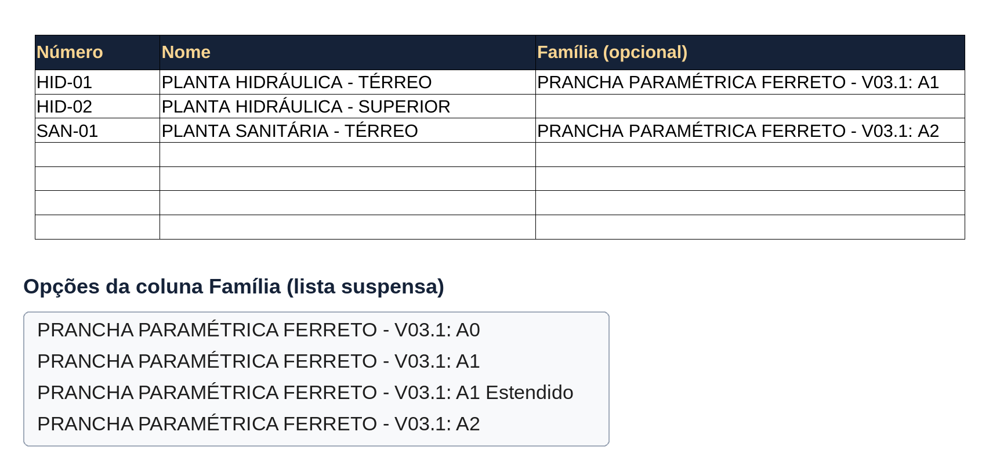
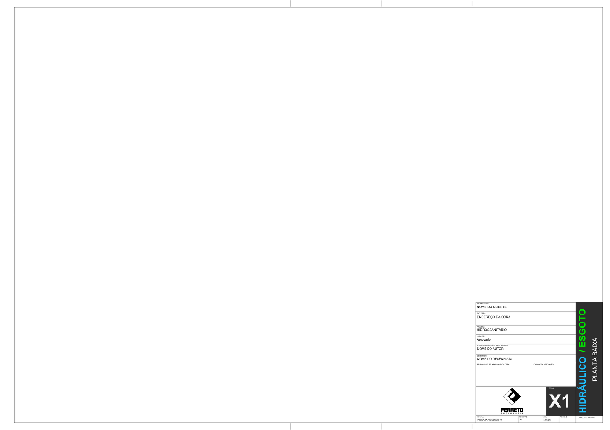
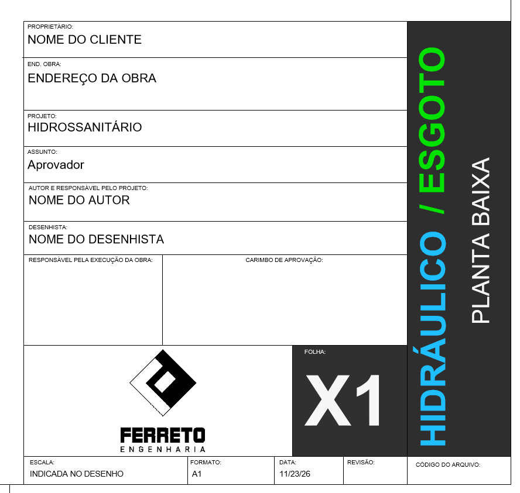
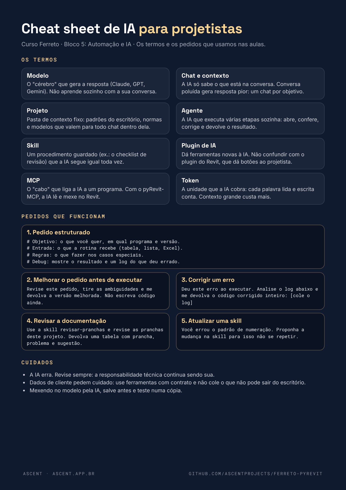

# Ferreto pyRevit

Extensão de exemplo do **Curso Ferreto: Produtividade, Automação e IA no Revit MEP** (Aula 18, "Seu primeiro plugin com pyRevit").

Ela cria a aba **Ferreto** no Revit com o botão **Criar Pranchas**, que cria várias pranchas de uma vez: você escolhe a família de prancha e digita a lista (ou importa de uma planilha do Excel).

## Requisitos

- Revit com o [pyRevit](https://github.com/pyrevitlabs/pyRevit) instalado.

## Downloads

### Modelo de planilha: [modelo-pranchas.xlsx](https://github.com/AscentProjects/ferreto-pyrevit/raw/master/modelo-pranchas.xlsx)

Uma prancha por linha: Número, Nome e Família. A coluna Família traz a lista suspensa com as pranchas do template Ferreto; em branco, o botão usa a família padrão escolhida na janela.



### Família de prancha: [PRANCHA PARAMÉTRICA FERRETO - V03.1.rfa](https://github.com/AscentProjects/ferreto-pyrevit/raw/master/familias/PRANCHA%20PARAM%C3%89TRICA%20FERRETO%20-%20V03.1.rfa)

Família de prancha da Ferreto Engenharia, com os tipos A0, A1, A1 Estendido e A2, disponibilizada com autorização dela. Carregue no projeto antes de usar o botão. O carimbo puxa os dados das Informações do projeto.





## Recursos de IA (Aula 19)

- [Cheat sheet de IA para projetistas (PDF)](https://github.com/AscentProjects/ferreto-pyrevit/raw/master/ia/cheat-sheet-ia.pdf): os termos do bloco (modelo, contexto, agente, skill, plugin de IA, MCP) e os pedidos que usamos nas aulas, numa página.
- [Skill revisar-pranchas](ia/skills/revisar-pranchas/SKILL.md): exemplo de skill com o checklist de revisão da documentação antes da entrega. Copie a pasta para as skills do seu Claude e adapte ao padrão do seu escritório.
- [Skill criar-script-dynamo](ia/skills/criar-script-dynamo/SKILL.md): escreve o nó Python do Dynamo a partir do seu pedido, com entrada, regras e log de erros (Aula 17).
- [Skill criar-plugin-pyrevit](ia/skills/criar-plugin-pyrevit/SKILL.md): monta um botão de pyRevit, com a estrutura de pastas, o script e a instalação para a equipe (Aula 18).
- [Caderno do projetista](ia/caderno/caderno-do-projetista.md) (Aula 20): regras de esgoto, caixas e reservatório da NBR 8160 e da NBR 5626, escritas com as nossas palavras, junto com os padrões do escritório. Cada regra tem código e diz onde achar o trecho na norma. Não substitui a norma.
- [Skill escrever-memorial](ia/skills/escrever-memorial/SKILL.md) (Aula 20): escreve o memorial descritivo a partir dos dados do modelo e confere cada trecho pelo caderno.
- [Memorial de exemplo](ia/memorial/memorial-banheiro-exemplo.md) (Aula 20): água fria, esgoto e ventilação de um banheiro da casa do curso, com os pontos que a IA levantou para o projetista confirmar.
- [Instruções do projeto no Claude](ia/projeto/instrucoes-do-projeto.md) (Aula 20): texto para colar num projeto do Claude e usar o caderno no seu escritório.
- [Agente de IA no Revit](ia/agente-no-revit/README.md) (Aula 21): instalação do MCP Server for Revit Python, onde costuma travar e os pedidos de conferência e correção pelo caderno.

Cada skill termina dizendo quando atualizá-la e quando a correção é só uma exceção daquele projeto.



## Instalar

No terminal (PowerShell ou Prompt de Comando):

```
pyrevit extend ui Ferreto https://github.com/AscentProjects/ferreto-pyrevit.git
```

Depois, no Revit, vá na aba **pyRevit** e clique em **Reload**. A aba **Ferreto** aparece.

## Usar

1. Abra o modelo e clique em **Ferreto > Criar Pranchas**.
2. Escolha a família de prancha padrão.
3. Escreva uma prancha por linha, no formato `número | nome | família (opcional)`:

```
HID-01 | PLANTA HIDRÁULICA - TÉRREO
HID-02 | PLANTA HIDRÁULICA - SUPERIOR
SAN-01 | PLANTA SANITÁRIA - TÉRREO | Família da prancha: Tipo
```

4. Ou clique em **Importar do Excel** e escolha uma planilha `.xlsx` com as colunas Número, Nome e Família (opcional). Use o modelo `modelo-pranchas.xlsx`: a coluna Família já traz a lista das pranchas do template Ferreto.
5. Clique em **Criar pranchas**. No fim, uma tabela mostra o que foi criado e o que foi pulado. Número que já existe no modelo é pulado.

Tudo roda numa transação só: um Ctrl+Z desfaz a criação inteira.

## Versão feita na Aula 18

A pasta [`aula-18/Ascent.extension`](aula-18/Ascent.extension) guarda o botão que montamos ao vivo na aula, do jeito que a IA escreveu. Ele cria a aba **Ascent** com o mesmo botão **Criar Pranchas**, com alguns recursos a mais: carimbo escolhido no formato `Família : Tipo`, validação de cada linha antes de criar (número repetido, caracteres que o Revit não aceita) e um relatório em que o número de cada prancha criada abre a prancha.

As duas versões ficam no repositório: a extensão da raiz (aba **Ferreto**) é a de referência, e a da Aula 18 é para você comparar com a que fez. Para usar a da aula, copie a pasta `Ascent.extension` para `%APPDATA%\pyRevit\Extensions` e clique em **pyRevit > Reload**. O passo a passo completo está no [LEIA-ME](aula-18/Ascent.extension/LEIA-ME.md) dela.

## Estrutura

```
Ferreto.tab/                     a aba
  Pranchas.panel/                o painel
    Criar Pranchas.pushbutton/   o botão
      script.py                  o código
      janela.xaml                a janela
      icon.png                   o ícone
      bundle.yaml                título e dica do botão
```

Feito pela [Ascent](https://ascent.app.br) para o curso da Ferreto Engenharia.
